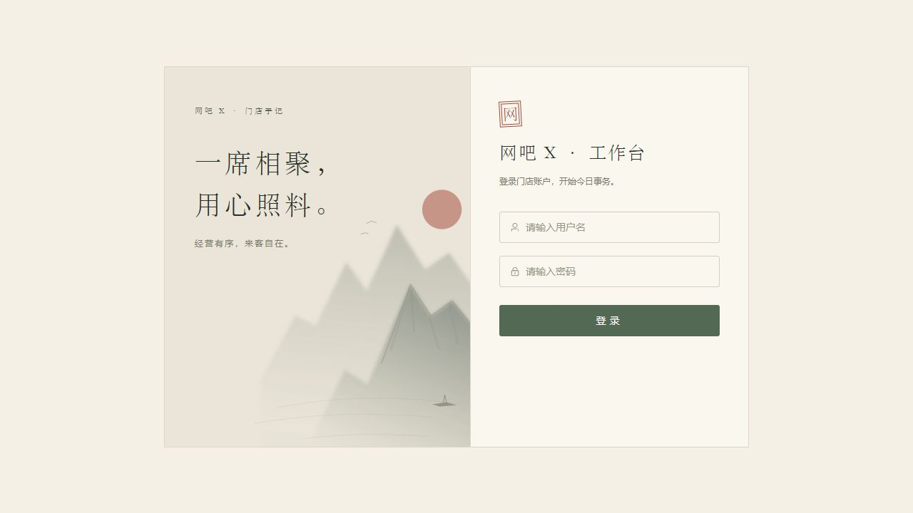
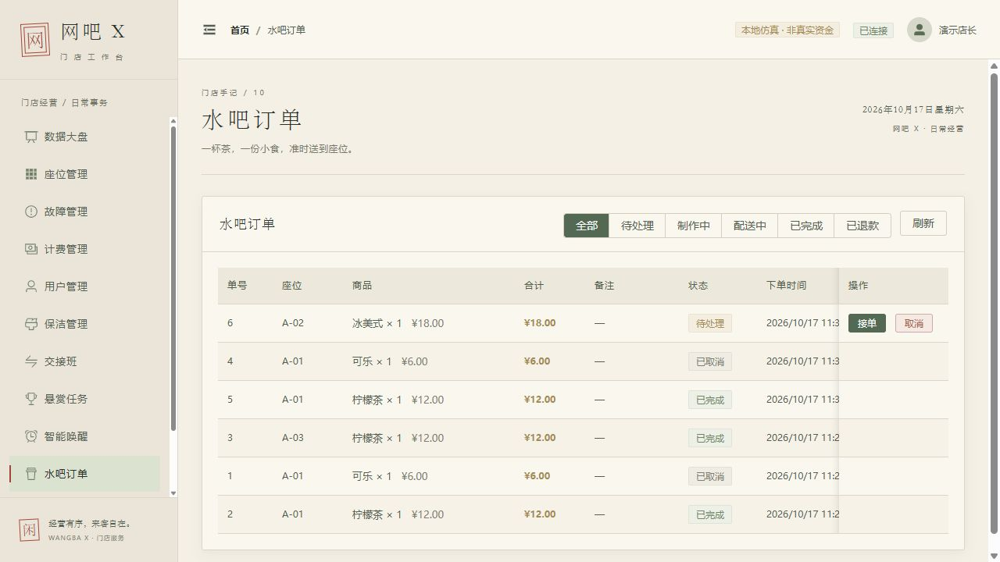
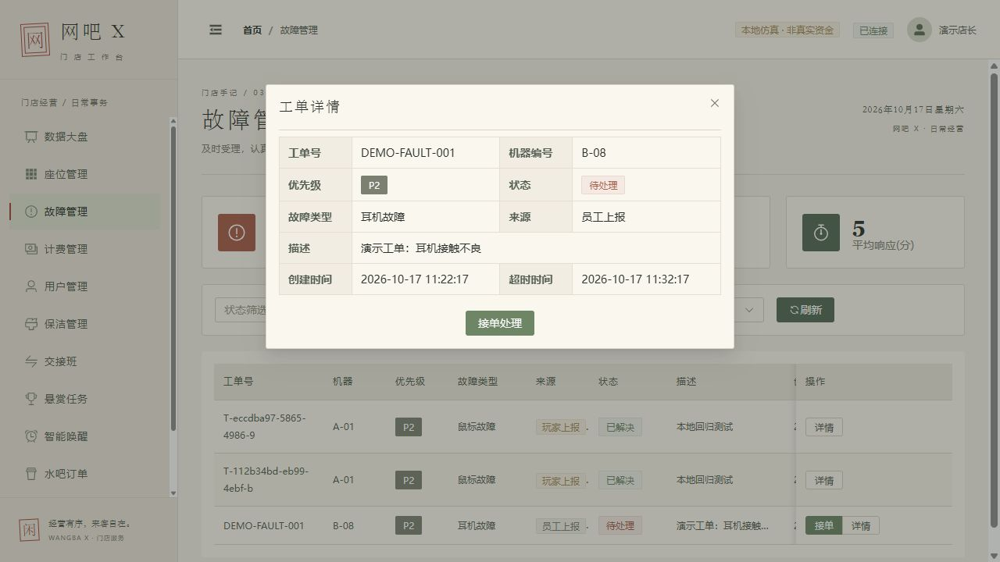
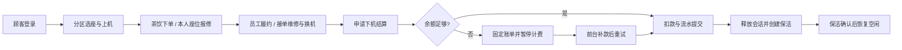

<div align="center">

# WangBa-X

**水墨风网吧服务与管理系统 · 全栈项目实践**


Vue 3 · TypeScript · Pinia · NestJS · TypeORM · Socket.IO · SQLite

[界面展示](#界面展示) · [工程亮点](#工程亮点) · [快速运行](#快速运行) · [验证记录](#验证记录) · [项目文档](#项目文档)

</div>

从选座上机、席间点单，到报修换机、下机结算与保洁，连接顾客自助端和员工工作台。项目以**业务状态、账户一致性、权限边界和失败恢复**为核心，适合用于全栈开发的代码展示与面试讲解。

> 当前为本机单进程演示项目。余额为演示资金；真实支付、短信、实名核验和电脑硬件控制尚未接入。Docker、PostgreSQL 和多实例部署尚未验收，不代表可直接生产上线。

## 界面展示

### 员工工作台

宣纸底色、宋体标题、松绿操作和朱砂提示贯穿表格、弹窗与图表。大盘从后端读取营收与座位统计，菜单与操作按员工岗位显示。

<a href="docs/images/ink-admin-dashboard.png"></a>

### 顾客自助端

<table>
<tr><th width="50%">此间，正好有位</th><th width="50%">分区选座</th></tr>
<tr><td></td><td></td></tr>
<tr><th>茶饮点单</th><th>故障报修</th></tr>
<tr><td></td><td></td></tr>
</table>

<details>
<summary>更多界面：管理登录、订单履约与操作弹窗</summary>





</details>

**截图说明**：以上为仓库保留的2026年10月17日本地演示实拍，数据不代表真实门店。近期权限变更已隐藏交接班、悬赏和唤醒导航，旧截图中的这些菜单不代表当前入口；大厅为示意布局。2026年10月21日内置浏览器白屏尚未完成视觉复验，没有把旧图标成新版本截图。最新行为以代码、[验证记录](docs/validation-report.md)和[能力边界](docs/project-showcase.md)为准。

## 工程亮点

| 业务难点 | 已实现的处理 | 可追溯证据 |
| --- | --- | --- |
| 客户端篡改余额或操作员 | 请求DTO与会员字段白名单；专用充值接口记录真实员工；顾客与员工身份隔离 | [权限与账户接口回归](backend/test/security-authorization.e2e-spec.ts) |
| 重试导致重复充值、重复点单 | UUID请求键、内容一致性检查、原请求结果查询；双端保留待确认请求 | [充值](docs/recharge-idempotency.md) / [订单幂等](docs/order-idempotency.md) |
| 余额不足结算后账单继续上涨 | 首次欠费申请固定账单并暂停计费，补款后按原账单结算；座位继续占用 | [低余额结算](docs/low-balance-settlement.md) |
| 故障处理与会话、机器脱节 | 报修绑定当前会话，换机原子迁移；原机器继续维修，离场维修后创建保洁 | [工单服务](backend/src/modules/fault/fault.service.ts) |
| 实时通知泄露给其他会员 | Socket握手验证、服务端授权订阅、本人房间隔离；入站和推送前重查身份 | [真实Socket回归](backend/test/socket-authorization.e2e-spec.ts) |
| 重连、换账号、请求乱序覆盖新状态 | 管理端先订阅再获取快照；在途去重，拒绝旧身份响应，加载中重放实时变化 | [Socket与恢复协议](docs/socket-authorization.md) |

这些能力已做定向验证，仍有明确范围：HTTP令牌即时撤销、完整审计、订单推送、顾客业务状态补偿和生产数据库并发约束尚待完善。

## 系统架构


两套Vue应用共用一个NestJS后端。REST负责业务状态变更，Socket负责已提交结果的通知；本地事务队列协调同进程SQLite写入。通知传输失败不回滚已提交业务，通过HTTP快照读取实际状态。

详见[架构与一致性边界](docs/01-architecture.md)、[核心数据模型](docs/02-data-model.md)。图中未将Redis、支付或PostgreSQL画入已落地链路。

## 业务闭环



按分钟计费，不足一分钟按一分钟；换机保留会话费率。欠费待结算不允许恢复计费、新点单或换机继续使用。真实电脑锁屏、断网不在此仿真范围内。

## 快速运行

需要 **Node.js 22+、npm、Git**。首次安装需要联网，SQLite驱动包含原生模块。

```powershell
git clone https://github.com/Y7NINE/WangBa-X-.git
cd WangBa-X-
npm run setup:local
npm run dev:local
```

已安装依赖后执行 `npm run dev:local`，Windows也可运行 `start-local.bat`。如果聊天内置浏览器白屏，请将下面地址复制到系统Chrome或Edge地址栏。

| 入口 | 地址 | 本地演示身份 |
| --- | --- | --- |
| 顾客端 | http://127.0.0.1:5180 | 手机号 `13800138001`，验证码 `123456` |
| 管理端 | http://127.0.0.1:5173 | `admin` / `admin123` |
| API文档 | http://127.0.0.1:3000/api | 受保护接口需要JWT |
| 健康检查 | http://127.0.0.1:3000/health | 正常返回 `status: ok`、`mode: demo` |

启动脚本编译后端，并按缺失记录补齐3区域、22座位和5位演示会员，初始余额300元；重复启动保留操作与余额。数据库为 `.local/demo.sqlite`，签名密钥也仅存于 `.local/`，均不提交。停止启动终端中的服务按Ctrl+C；复用的既有前端服务需在原终端停止。

体验路径：[五分钟演示与面试讲解](docs/demo-and-interview.md)。

## 验证记录

最近的定向验证基线如下。各项实际执行日期、范围和本次上传前复验结果见[验证报告](docs/validation-report.md)。

| 检查 | 最近基线 | 验证范围 |
| --- | --- | --- |
| 后端业务接口 | 244项通过 | 真实HTTP/JWT/内存SQLite，网关替身 |
| 实时通信 | 47项通过 | 真实HTTP与Socket客户端，内存库、随机本地端口 |
| 管理端 | 121项通过 | 权限、组件、请求与重连竞态 |
| 顾客端 | 47项通过 | 身份、订单确认、结算及连接等 |
| 三端构建 | 分别通过 | NestJS构建、Vue类型检查与生产打包 |

```powershell
npm run test:security --prefix backend -- --no-cache --silent
npm run test:socket --prefix backend -- --no-cache --silent
npm test --prefix frontend -- --run
npm test --prefix customer
npm run build --prefix backend
npm run build --prefix frontend
npm run build --prefix customer
```

真实Socket测试复用frontend中的客户端，需先安装backend/frontend依赖。以上后端回归使用内存库；`npm run test:local` 是另外的13组历史演示检查，会向演示库写数据，本次没有执行。测试通过不等同于浏览器完整验收或生产部署验收。当前仍有Sass旧API和构建包体提示。

## 项目文档

| 目的 | 入口 |
| --- | --- |
| 快速了解已实现与未实现 | [项目能力与边界](docs/project-showcase.md) |
| 本地演示、面试讲解与简历措辞 | [演示与面试手册](docs/demo-and-interview.md) |
| 架构、事务与通知设计 | [架构](docs/01-architecture.md) / [数据模型](docs/02-data-model.md) |
| 实际执行的测试与限制 | [验证报告](docs/validation-report.md) |
| 业务细节 | [充值](docs/recharge-idempotency.md) / [订单](docs/order-idempotency.md) / [低余额结算](docs/low-balance-settlement.md) / [Socket](docs/socket-authorization.md) |
| 历史截图与操作步骤 | [本地仿真操作手册](docs/06-local-simulation.md) / [水墨设计](docs/07-hall-ink-admin.md) |
| 改动记录 | [CHANGELOG](CHANGELOG.md) / [详细迭代记录](docs/iteration-progress.md) |

```text
backend/    NestJS API、实体、事务服务与隔离回归
customer/   Vue顾客端
frontend/   Vue员工管理端
scripts/    依赖安装、本地启动与历史HTTP演示检查
docs/       架构、协议、截图、验证与演示说明
database/   历史SQL与部署资料（未完成生产验收）
.local/     本机密钥、数据库、日志和备份（不提交）
```

## 后续方向

- 补齐剩余权限、请求DTO与敏感操作审计。
- 订单通知、顾客工单展示及换机后会话恢复，订单与保洁页重连补偿。
- 隔离CI、可复现Docker；真实PostgreSQL迁移、数据库约束及多实例并发验收。
- 基础验收后再实现真实布局下的多人连座锁座、到期释放与幂等确认。
- 库存、会员套餐、真实支付短信和设备代理仍为后续方向。

---

<div align="center">墨色入界面，服务落到每一席。<br><a href="https://github.com/Y7NINE/WangBa-X-/issues">反馈问题</a> · <a href="#wangba-x">回到顶部</a></div>
