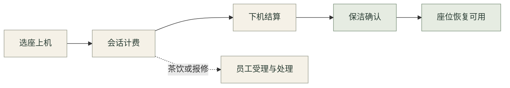

<div align="center">

# WangBa-X

**水墨风网吧服务与管理系统**


从顾客找到一个好座位，到员工照看好每一席。<br>
让选座、上机、茶饮、报修与门店日常，在同一套系统里顺畅衔接。

<code>Vue 3 + TypeScript</code> · <code>NestJS + Socket.IO</code><br>
<code>SQLite · 本地仿真</code> · <code>Node.js 22+</code>

[界面一览](#界面一览) · [快速开始](#快速开始) · [功能与流程](#功能与流程) · [开发与验证](#开发与验证) · [文档导航](#文档导航)

</div>

> **当前版本 · 本地演示 / 持续开发**<br>
> 提供可运行的双端业务仿真。演示余额不是实际资金；真实支付、短信、实名核验与电脑硬件控制尚未接入。

## 界面一览

### 管理端 · 一席之间，尽在眼前

宣纸底色、墨色文字、松绿操作与朱砂状态，贯穿工作台、表格和弹窗。今日营收、人次与趋势读取后端统计接口。

<a href="docs/images/ink-admin-dashboard.png"></a>

### 顾客端 · 找个座，开一局

首页进入选座、茶饮和报修；大厅选座支持区域筛选、实时状态与列表切换。**大厅为示意布局，实际位置以门店为准。**

<table>
  <tr>
    <th width="50%">顾客首页 · 选座与服务入口</th>
    <th width="50%">大厅选座 · 分区与座位状态</th>
  </tr>
  <tr>
    <td><a href="docs/images/local-home.png"></a></td>
    <td><a href="docs/images/ink-hall.png"></a></td>
  </tr>
</table>

<div align="center"><sub>点击截图可查看原图 · 截图来自本地仿真环境</sub></div>

<details>
<summary><strong>展开更多界面：管理登录、订单履约与操作弹窗</strong></summary>

#### 管理登录


#### 订单履约


#### 表单与弹窗


更多操作实拍见 [本地仿真操作手册](docs/06-local-simulation.md)；仓库中的“网吧管理系统效果图”和“网吧用户端效果图”目录为旧版演示截图。

</details>

## 快速开始

准备 **Node.js 22+、npm 和 Git**。首次安装需要联网下载依赖，SQLite 使用 `better-sqlite3` 原生模块。

```powershell
git clone https://github.com/Y7NINE/WangBa-X-.git
cd WangBa-X-
npm run setup:local
npm run dev:local
```

已安装依赖后，只需 `npm run dev:local`。Windows 也可双击根目录的 `start-local.bat`。

| 入口 | 本地地址 | 演示账号 |
| :--- | :--- | :--- |
| **顾客端** | [127.0.0.1:5180](http://127.0.0.1:5180) | 手机号 `13800138001` · 验证码 `123456` |
| **管理端** | [127.0.0.1:5173](http://127.0.0.1:5173) | `admin` / `admin123` |
| **API 文档** | [127.0.0.1:3000/api](http://127.0.0.1:3000/api) | 受保护接口需登录令牌 |
| **健康检查** | [127.0.0.1:3000/health](http://127.0.0.1:3000/health) | `mode: demo` 表示仿真模式 |

首次初始化提供 **3 个区域 · 22 个座位 · 5 个演示会员**，每位会员初始余额为 300 元演示资金，并包含待清理和故障座位，方便体验员工处理流程。

<details>
<summary><strong>演示数据、重复启动与停止服务</strong></summary>

- 启动脚本编译后端、初始化独立的 `.local/demo.sqlite`，再启动三个服务；默认绑定本机地址，不会覆盖原有 `netcafe.db`。
- 重复启动保留记录与余额，不自动重置；固定验证码仅在非生产演示模式生效，不发送短信。
- 按 **Ctrl+C** 停止本次启动的服务。复用的既有前端服务需在原终端停止。
- 当前以 **npm + package-lock.json** 为验证路径；原有 pnpm 文件保留供参考，未重新验收 pnpm 安装流程。

</details>

## 功能与流程

| 面向谁 | 已跑通的能力 |
| :--- | :--- |
| **顾客 · 找座与上机** | 实时空位、区域单价、基础预算试算、大厅示意与列表切换 |
| **顾客 · 席间服务** | 茶饮购物车、后端定价与余额扣款、订单进度、本人座位报修与服务记录 |
| **员工 · 现场协作** | 订单履约与取消退款、故障接单、换机迁移会话、维修及保洁确认 |
| **门店 · 计费与记录** | 上机费率快照、暂停恢复、余额结算、重复结算保护、交易流水与管理大盘 |



演示计费不足 1 分钟按 1 分钟计，结算金额四舍五入到分；换机保留原会话费率。会员折扣、包夜和复杂套餐仍待完善。

## 开发与验证

**最近一次本地验收（2026-10-17）**：顾客端 **18 项**、管理端 **36 项**测试通过，三端构建及 **13 组 HTTP 业务检查**通过。这是本地验证记录，并非实时 CI 状态。

| 层级 | 技术选型 |
| :--- | :--- |
| 顾客端 / 管理端 | Vue 3 · TypeScript · Vite · Pinia · Element Plus |
| 管理端图表 | ECharts |
| API 与实时通信 | NestJS · TypeORM · JWT · Socket.IO |
| 本地仿真 | SQLite · 独立演示数据 · 根目录启动脚本 |

<details>
<summary><strong>测试与构建命令</strong></summary>

```powershell
# 顾客端：18 项测试
npm test --prefix customer

# 管理端：36 项测试
npm test --prefix frontend -- --run

# 三端构建与类型检查
npm run build --prefix backend
npm run build --prefix customer
npm run build --prefix frontend

# 保持本地仿真运行，再执行 13 组业务检查
npm run test:local
```

业务检查会在演示库中创建用户与交易记录，覆盖并发抢座、暂停计费、越权请求、后端定价、订单履约与退款、报修换机、重复结算及保洁恢复。至少需要 2 个空闲座位，`LOCAL_API` 仅应指向本地仿真环境；结果保存在 `.local/smoke-results.json`。

Sass 旧 API 与大体积包提示仍存在。原有后端 e2e 测试文件保留，本轮核心流程使用根目录 HTTP 业务检查脚本验证。

</details>

<details>
<summary><strong>项目目录</strong></summary>

```text
WangBa-X-/
├── backend/       NestJS API、演示数据初始化与业务服务
├── customer/      Vue 顾客端、大厅选座与水墨界面
├── frontend/      Vue 员工管理工作台
├── scripts/       安装、启动与 HTTP 业务检查
├── docs/          产品调研、架构、功能说明与界面实拍
├── database/      原有数据库初始化资料
└── .local/        本机数据库、签名密钥与检查结果（不提交）
```

</details>

## 文档导航

| 想了解什么 | 阅读入口 |
| :--- | :--- |
| 为什么做、优先解决什么问题 | [市场调研与产品路线](docs/04-market-product-plan.md) |
| 系统场景与整体说明 | [系统图文说明](docs/05-illustrated-guide.md) |
| 如何运行与体验完整流程 | [本地仿真操作手册](docs/06-local-simulation.md) |
| 大厅选座与水墨界面的细节 | [大厅选座与水墨管理端](docs/07-hall-ink-admin.md) |
| 最近新增和修复了什么 | [更新记录](CHANGELOG.md) |

## 接下来

- [ ] 商品库存、会员套餐、订单请求幂等与超时确认。
- [ ] 员工细分权限、完整请求 DTO、审计及其他模块统计口径复核。
- [ ] 门店布局编辑器与多人连座预约。
- [ ] 真实支付与退款、短信、实名核验、设备监测和电脑控制。

当前采用 **本机单进程 SQLite 仿真**，同一进程内的事务队列协调并发写入；生产多进程部署仍需数据库锁、唯一约束及迁移方案。现有 Docker / PostgreSQL 配置作为开发资料保留，尚未完成验收，请以本文的本地启动流程为准。

---

<div align="center">
  <sub>墨色入界面，服务落到每一席。</sub><br>
  <sub><a href="https://github.com/Y7NINE">Y7NINE</a> · <a href="https://github.com/Y7NINE/WangBa-X-/issues">问题反馈</a> · <a href="#wangba-x">回到顶部</a></sub>
</div>
