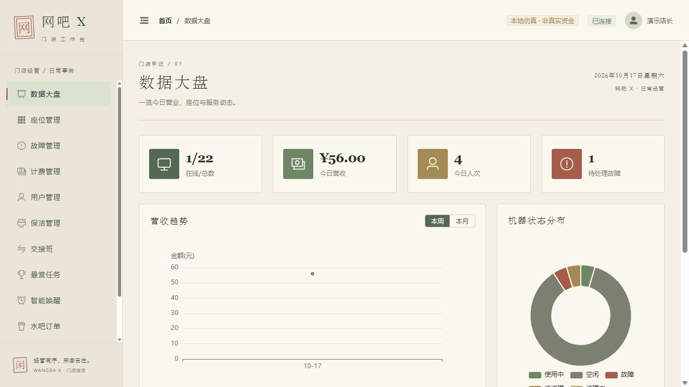
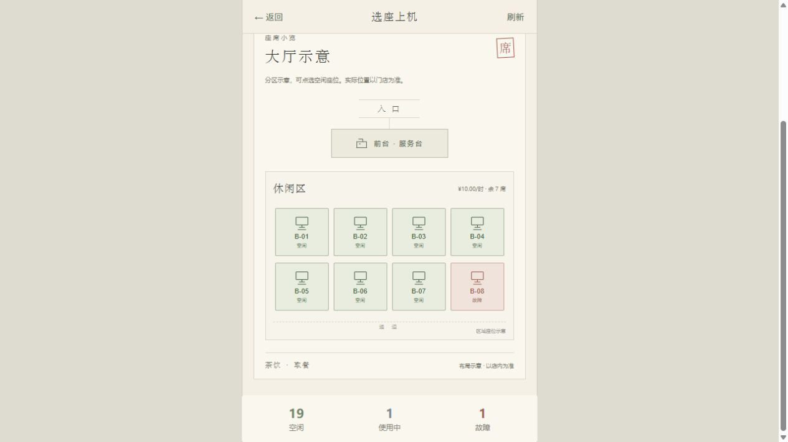

# WangBa-X · 水墨风网吧服务与管理系统

面向顾客和门店员工的网吧服务系统，基于 Vue 3、NestJS 和 Socket.IO。当前提供可运行的本地仿真环境：顾客可以选座、上机、点单、报修、查看记录和下机结算；员工可以处理订单、工单、保洁及计费事务。

> 当前是本地演示与持续开发版本。演示余额不是实际资金，不连接真实支付、短信、实名核验或电脑硬件控制。

## 界面预览

### 管理端 · 水墨工作台



宣纸底色、墨色文字、松绿操作与朱砂状态贯穿导航、表格、表单和弹窗。大盘今日营收、人次与趋势读取后端统计接口。

### 顾客端 · 大厅选座



选座页支持大厅示意、区域筛选和列表切换。座位状态来自后端；大厅布局仅供参考，实际位置以门店为准。

更多截图与说明：[界面更新图文说明](docs/07-hall-ink-admin.md) · [本地仿真操作手册](docs/06-local-simulation.md)。仓库中的“网吧管理系统效果图”和“网吧用户端效果图”目录为旧版演示截图。

## 本地启动

需要 **Node.js 22 或更新版本**、npm 和 Git。首次安装需联网下载依赖，SQLite 使用 better-sqlite3 原生模块。

```powershell
git clone https://github.com/Y7NINE/WangBa-X-.git
cd WangBa-X-
npm run setup:local
npm run dev:local
```

已安装依赖后，直接执行 `npm run dev:local`。Windows 也可双击根目录的 `start-local.bat`。

| 服务 | 地址 | 本地演示账号 |
|---|---|---|
| 顾客端 | [127.0.0.1:5180](http://127.0.0.1:5180) | 13800138001 / 验证码123456 |
| 管理端 | [127.0.0.1:5173](http://127.0.0.1:5173) | admin / admin123 |
| API文档 | [127.0.0.1:3000/api](http://127.0.0.1:3000/api) | 受保护接口需登录令牌 |
| 健康检查 | [127.0.0.1:3000/health](http://127.0.0.1:3000/health) | `mode: demo` 表示仿真模式 |

启动脚本会编译后端、初始化独立的 `.local/demo.sqlite`，然后启动三个服务。默认绑定本机地址，不会覆盖原有 `netcafe.db`。按 Ctrl+C 停止本次启动的服务；复用的既有前端服务在原终端停止。

首次初始化包含3个区域、22个座位、5个演示会员，每个会员初始余额300元；并提供待清理和故障座位用于体验员工处理流程。重复启动保留操作记录和余额，不自动重置。固定验证码仅在非生产演示模式生效，不会发送短信。

本次更新以 **npm 和 package-lock.json** 为验证路径；原有 pnpm 文件保留供参考，未对 pnpm 安装流程重新验收。

## 已跑通的主要流程


| 模块 | 当前能力 |
|---|---|
| 顾客首页与选座 | 实时空位、区域单价、基础预算试算、大厅示意及列表切换 |
| 会话计费 | 上机费率快照、暂停恢复、余额结算、重复结算保护、交易流水 |
| 茶饮与小食 | 后端演示菜单、购物车、后端重新定价、余额扣款、履约进度及取消退款 |
| 故障工单 | 本人座位报修、重复问题检查、员工接单、换机迁移会话及维修恢复 |
| 保洁 | 下机生成任务、员工开始和完成确认、清理中状态持久保存 |
| 账户记录 | 当前会话、上机记录、消费与充值流水、本人点单和报修记录 |
| 管理工作台 | 座位、会员、订单、故障、计费、保洁、交班、报表及设置页面 |

演示计费按开始分钟计算，不足1分钟按1分钟计，结算金额四舍五入到分；换机保留原会话费率。会员折扣、包夜和复杂套餐仍需进一步完善。

## 检查与构建

```powershell
# 顾客端测试：18项
npm test --prefix customer

# 管理端测试：36项
npm test --prefix frontend -- --run

# 编译与完整类型检查
npm run build --prefix backend
npm run build --prefix customer
npm run build --prefix frontend

# 保持本地仿真服务运行，再执行13组业务检查
npm run test:local
```

业务检查会在演示库中创建测试用户与交易记录，覆盖并发抢座、暂停计费、越权请求、后端定价、订单履约与退款、报修换机、重复结算及保洁恢复。至少需要2个空闲座位；不要把 `LOCAL_API` 指向其他环境。最近结果保存在 `.local/smoke-results.json`。

上述测试和三端构建已在本地通过。Sass旧API和大体积包提示仍存在。原有后端e2e测试文件保留，本轮核心流程验证使用根目录的HTTP业务检查脚本。

## 项目结构

```text
backend/       NestJS API、SQLite演示初始化、业务服务
customer/      Vue顾客端、大厅选座与水墨界面
frontend/      Vue员工管理工作台
scripts/       依赖安装、一键启动、HTTP业务回归检查
docs/          调研、架构、功能说明和实拍截图
database/      原有数据库初始化资料
.local/        本机演示数据库、签名密钥与检查结果（不提交）
```

## 设计与业务文档

- [市场调研与产品路线](docs/04-market-product-plan.md)：公开来源、痛点假设、试点方法与优先级。
- [系统图文说明](docs/05-illustrated-guide.md)：业务场景和历史演进。
- [本地仿真操作手册](docs/06-local-simulation.md)：运行、账号、流程实拍与验收范围。
- [大厅选座与水墨管理端](docs/07-hall-ink-admin.md)：本次界面更新和验证情况。
- [更新记录](CHANGELOG.md)。

## 后续工作与边界

目前支持本机单进程SQLite仿真。并发写入通过同一进程的事务队列协调，不能替代生产多进程部署所需的数据库锁、唯一约束和迁移方案。

优先待完善：订单请求幂等与超时确认、商品库存、会员套餐、员工细分权限、完整请求DTO与审计、门店布局编辑器及多人连座预约。真实支付/退款、短信、实名核验、设备监测和电脑控制尚未接入。其他业务模块的统计口径仍需逐项复核。

现有Docker/PostgreSQL配置作为开发资料保留，本轮没有验收Docker或生产部署；请以本文的本地启动流程为准。
