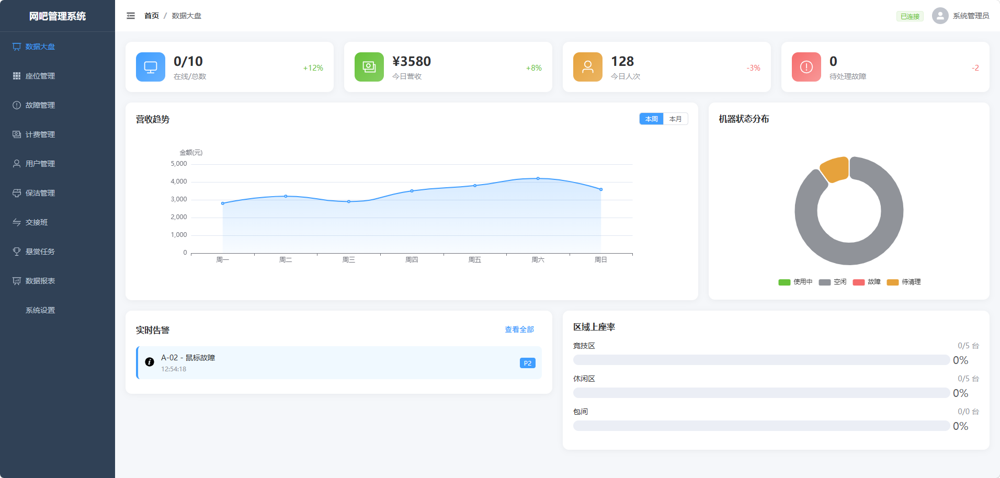
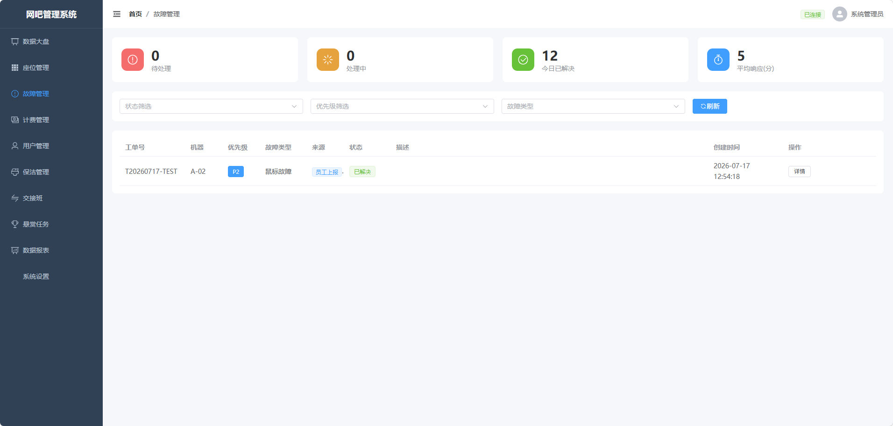
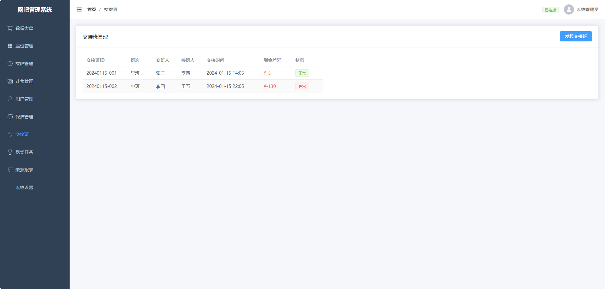
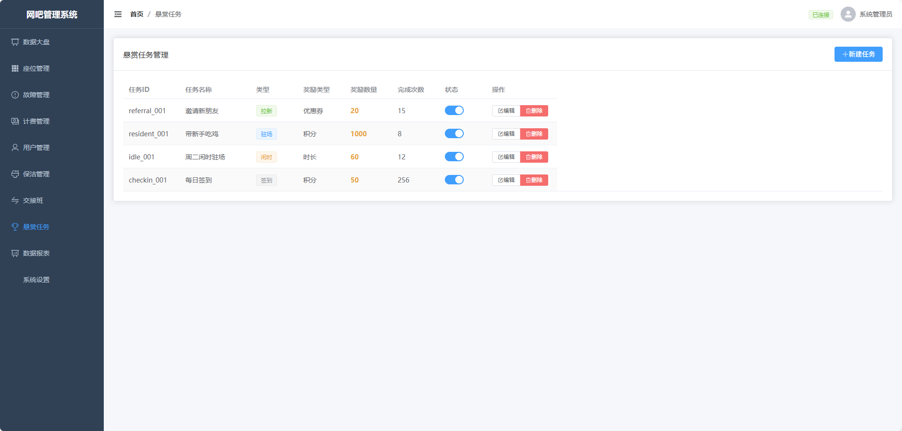
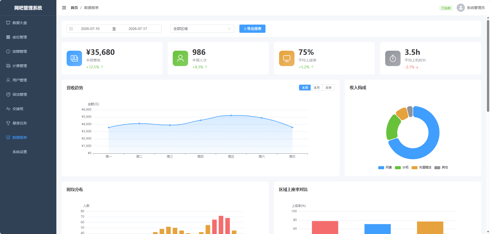
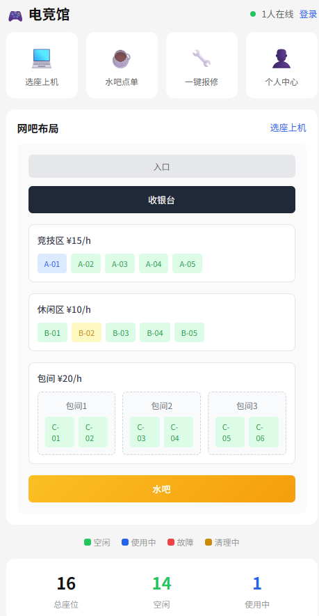

# 🎮 WangBa-X 网吧综合管理系统

一套完整的网吧综合管理与服务软件系统，专为高端电竞馆设计，支持实时座位管理、故障运维、计费引擎、保洁管理、游戏化任务等功能。

## 📸 系统效果展示

### 管理后台

**数据大盘**


**座位管理**


**故障管理**


**计费管理**


**用户管理**


**保洁管理**


**交接班**


**悬赏任务**


**数据报表**


### 用户端

**用户端首页**


## ✨ 功能特性

### 🖥️ 管理后台（收银台）
- **实时座位图** - 可视化座位状态，支持平面图/列表切换
- **故障运维** - 自动监控+主动上报，实时告警推送
- **计费引擎** - 多种计费策略，支持包夜、阶梯计费
- **保洁管理** - 下机自动通知，扫码确认清理
- **交接班** - 盲审交接系统，防止财务漏洞
- **数据报表** - 营收趋势、上座率、故障统计
- **悬赏任务** - 游戏化运营，提升用户粘性

### 📱 用户端（顾客使用）
- **实时座位状态** - 查看网吧布局和座位情况
- **选座上机** - 点击空闲座位直接上机
- **一键报修** - 快速报告设备故障
- **水吧点单** - 在线下单，送到座位
- **个人中心** - 余额、积分、上机记录

### 🔧 核心功能
- **故障自动检测** - 外设电量预警、网络波动监控
- **保洁状态机** - 下机→待清理→清理中→空闲
- **幽灵机检测** - 底层进程核对，防止逃费
- **智能唤醒** - 通宵包夜叫醒服务
- **游戏化任务** - 拉新任务、驻场任务、成就徽章

## 🛠️ 技术栈

### 后端
- **框架**: Nest.js (Node.js)
- **数据库**: SQLite / PostgreSQL
- **实时通信**: WebSocket (Socket.io)
- **认证**: JWT

### 前端
- **框架**: Vue 3 + TypeScript
- **UI库**: Element Plus
- **状态管理**: Pinia
- **图表**: ECharts
- **构建工具**: Vite

## 📁 项目结构

```
WangBa-X/
├── backend/                 # 后端服务
│   ├── src/
│   │   ├── modules/        # 业务模块
│   │   │   ├── auth/       # 认证授权
│   │   │   ├── machine/    # 机器管理
│   │   │   ├── fault/      # 故障运维
│   │   │   ├── billing/    # 计费引擎
│   │   │   ├── cleaning/   # 保洁管理
│   │   │   ├── shift/      # 交接班
│   │   │   ├── bounty/     # 悬赏任务
│   │   │   └── wakeup/     # 智能唤醒
│   │   └── common/         # 公共模块
│   └── package.json
├── frontend/                # 管理后台
│   ├── src/
│   │   ├── views/          # 页面组件
│   │   ├── stores/         # 状态管理
│   │   └── api/            # API封装
│   └── package.json
├── customer/                # 用户端
│   ├── src/
│   │   └── views/          # 页面组件
│   └── package.json
└── README.md
```

## 🚀 快速开始

### 环境要求
- Node.js >= 18
- pnpm (推荐)

### 安装步骤

1. **克隆项目**
```bash
git clone https://github.com/Y7NINE/WangBa-X-.git
cd WangBa-X-
```

2. **安装后端依赖**
```bash
cd backend
pnpm install
```

3. **安装管理后台依赖**
```bash
cd ../frontend
pnpm install
```

4. **安装用户端依赖**
```bash
cd ../customer
pnpm install
```

5. **初始化数据库**
```bash
cd ../backend
npx ts-node -r tsconfig-paths/register src/database/seed.ts
```

6. **启动服务**

```bash
# 启动后端 (终端1)
cd backend
npx ts-node -r tsconfig-paths/register src/main.ts

# 启动管理后台 (终端2)
cd frontend
npx vite --port 5173

# 启动用户端 (终端3)
cd customer
npx vite --port 5180
```

7. **访问系统**
- 管理后台: http://localhost:5173
- 用户端: http://localhost:5180
- API文档: http://localhost:3000/api

### 默认账号
- 用户名: `admin`
- 密码: `admin123`

## 📊 API接口

### 公开接口（无需认证）
- `GET /machines` - 获取机器列表
- `GET /areas` - 获取区域列表

### 需认证接口
- `POST /auth/login` - 用户登录
- `POST /billing/sessions` - 开始上机
- `PATCH /billing/sessions/:id/end` - 结束上机
- `POST /faults/tickets` - 创建故障工单

完整API文档访问: http://localhost:3000/api

## 🎯 核心业务流程

```
用户上机流程:
扫码登录 → 选择座位 → 确认上机 → 开始计费 → 使用设备 → 下机结算

故障处理流程:
故障检测 → 自动告警 → 网管接单 → 现场处理 → 完成修复

保洁流程:
用户下机 → 待清理状态 → 通知保洁 → 开始清理 → 清理完成 → 座位空闲
```

## 📝 开发计划

- [x] 基础座位管理
- [x] 故障运维系统
- [x] 计费引擎
- [x] 保洁管理
- [x] 用户端页面
- [x] 数据报表
- [ ] 微信小程序
- [ ] PC客户端（Electron）
- [ ] 水吧进销存
- [ ] 电竞赛事系统

## 🤝 贡献

欢迎提交 Issue 和 Pull Request！

## 📄 许可证

MIT License

## 👨‍💻 作者

- GitHub: [@Y7NINE](https://github.com/Y7NINE)

---

⭐ 如果这个项目对你有帮助，请给个 Star 支持一下！
