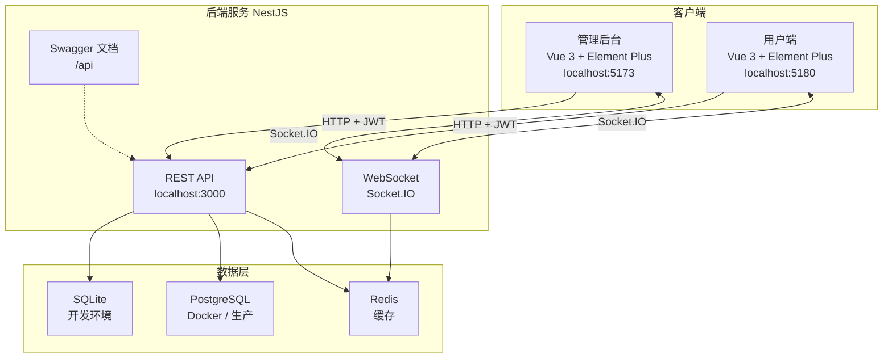
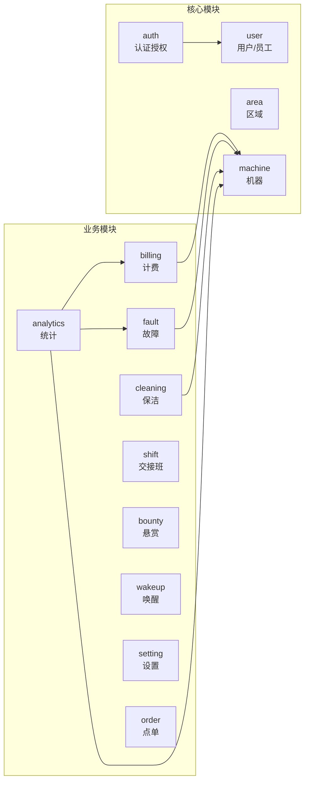

# 系统架构

WangBa-X 采用前后端分离架构，由三端 + 一个后端服务组成。

## 整体架构

## 后端模块

## 技术栈

| 层级 | 技术 | 说明 |
|------|------|------|
| 管理后台 | Vue 3 + TypeScript + Element Plus | 收银台/管理端 |
| 用户端 | Vue 3 + TypeScript + Element Plus | 顾客自助端 |
| 状态管理 | Pinia | Vue 3 官方推荐 |
| 图表 | ECharts | 数据可视化 |
| 后端框架 | Nest.js | 企业级 Node.js |
| ORM | TypeORM | entities 为唯一真源 |
| 数据库 | SQLite / PostgreSQL | 开发/生产双轨 |
| 实时通信 | Socket.IO | 状态秒级推送 |
| 认证 | JWT | 员工/顾客双主体 |
| 构建 | Vite | 极速开发体验 |

## 双数据库策略

| 场景 | 数据库 | 同步方式 |
|------|--------|----------|
| 本地开发 | SQLite | `synchronize: true` 自动建表 |
| Docker / 生产 | PostgreSQL | `init.sql` 冷启动 + migrations |

详见 [database/README.md](../database/README.md)。
