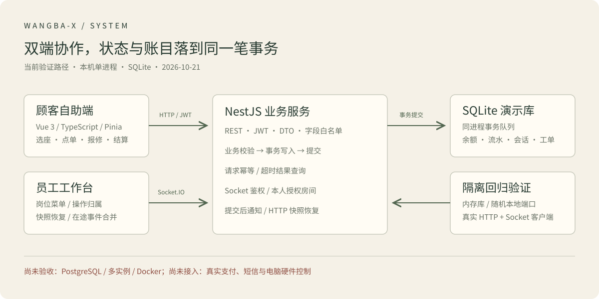
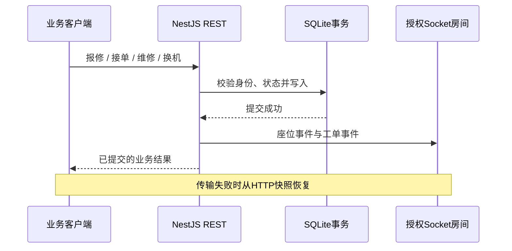

# 当前架构与一致性边界

更新于2026年10月21日。当前已验证路径为两套Vue应用、一个NestJS服务与本机SQLite，未完成PostgreSQL、Redis或多实例运行验收。

## 请求与身份

顾客与员工通过JWT访问REST，员工角色包括admin、manager、cashier、technician、cleaner。服务端角色守卫和业务归属校验负责授权，前端菜单和按钮用于呈现允许操作；不能用隐藏按钮替代后端校验。DTO拒绝未知字段，会员资料更新使用白名单，余额走专用充值、消费与退款流水。

HTTP和Socket共用TokenModule配置。Socket验证签名、过期时间与数据库当前身份，并按服务端身份分配主题房间；入站与发送前重新检查。顾客只获得本人的工单/订单主题权限。HTTP旧令牌即时撤销仍未完成，员工表也没有独立账户启停字段。

## 本地事务

`backend/src/common/local-transaction.ts` 以DataSource为单位串行调度同进程事务。上机占位、订单扣款、退款、结算释放与保洁创建在相应事务内提交，失败回滚。

充值和订单以UUID请求键识别重试，内容不一致时拒绝复用。结果查询用于网络超时后确认；请求幂等不表示跨实例并发控制已验收。低余额结算先提交固定账单和暂停状态，再返回需补款的业务结果，避免抛错把固定账单回滚。

## 提交后的通知

工单创建、接单、维修和换机已接通知；订单目前仅有订阅授权，还没有业务推送。推送异常不将已提交业务改成HTTP失败。没有持久化outbox、送达确认、跨请求序列号或离线事件重放。

管理端区域/座位/工单在重连时补HTTP快照，工单先确认订阅，再拉快照；在途查询去重、拒绝旧身份响应，加载期间合并新事件。顾客业务通知展示、换机后的会话恢复和订单/保洁页补偿仍待完善。

## 数据库与部署

演示入口使用 `.local/demo.sqlite`，初始化按缺失记录补齐数据，不主动重置余额。启动脚本仅绑定本机。测试使用独立内存库与随机端口，不依赖演示服务。

已有数据库迁移文件及部署资料只代表实现材料，不能据此认定真实PostgreSQL迁移已跑通。SQLite事务队列只协调同进程，生产多实例仍需数据库级约束、锁、迁移与压力验证。Redis当前不在已验证数据链路中。

详见[验证报告](validation-report.md)、[能力边界](project-showcase.md)与[协议说明](socket-authorization.md)。
