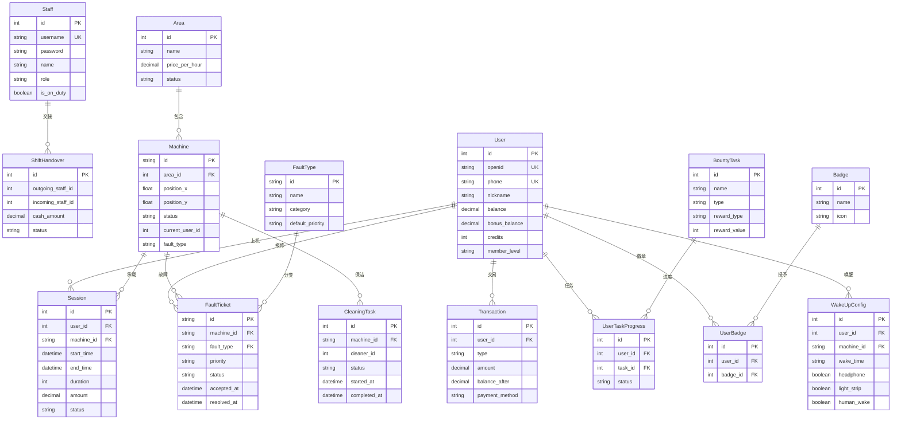
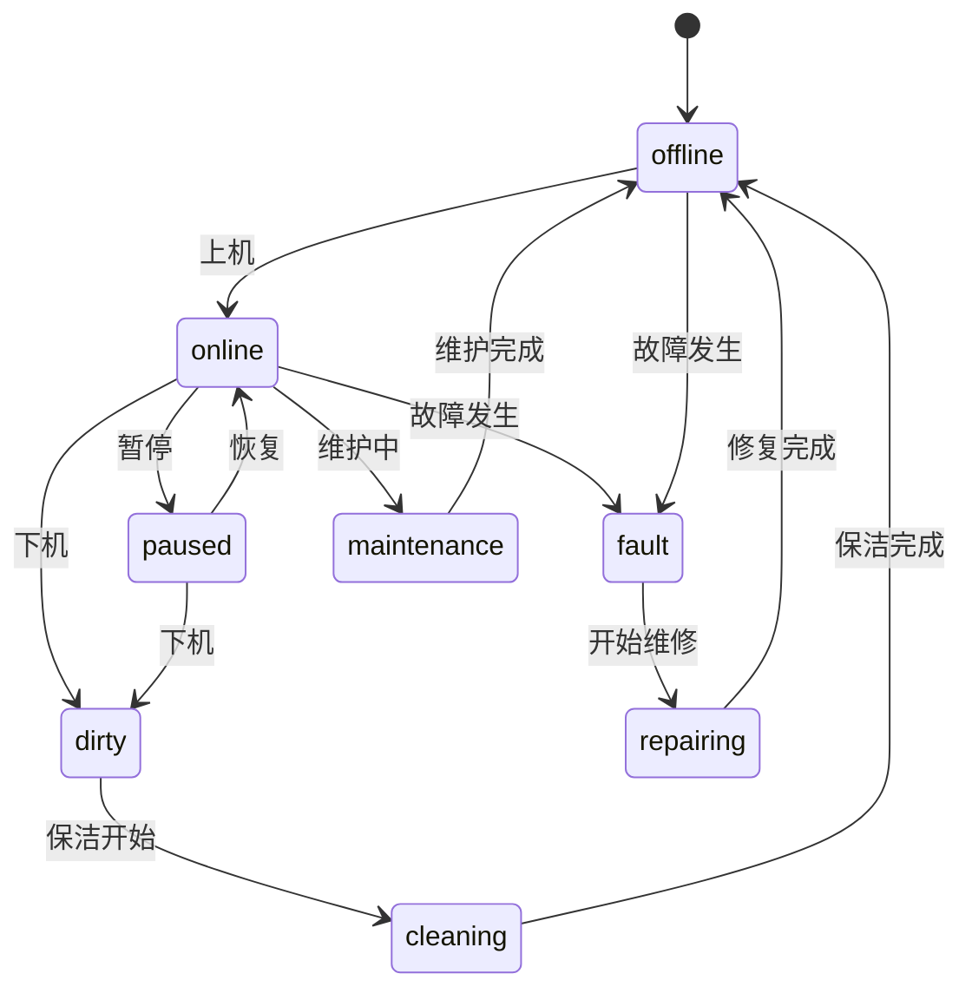
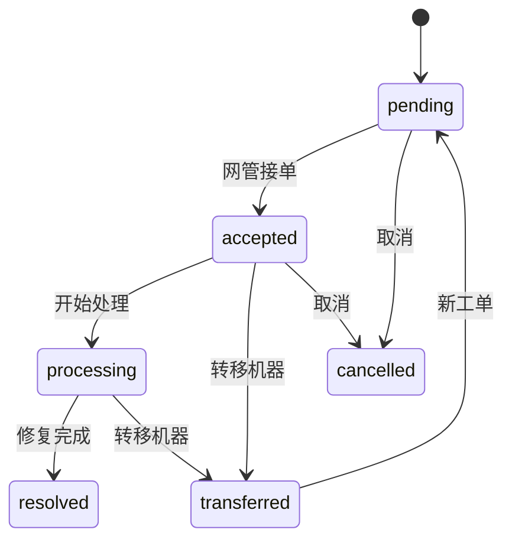
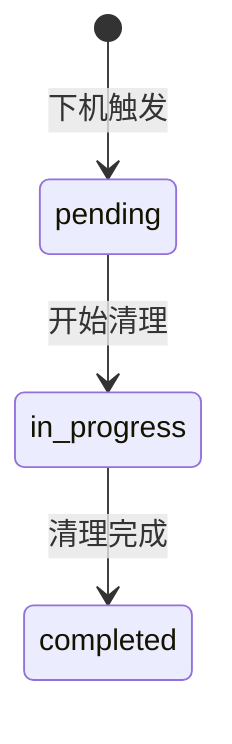

# 数据模型

以 TypeORM entities 为唯一真源。下图覆盖核心业务表。

## ER 图

## 核心表说明

| 表名 | 说明 | 主要字段 |
|------|------|----------|
| `staff` | 员工账号 | username, password, role |
| `users` | 顾客 | phone, balance, credits, member_level |
| `areas` | 区域 | name, price_per_hour |
| `machines` | 机器 | id, area_id, status, current_user_id |
| `sessions` | 上机记录 | user_id, machine_id, start_time, amount |
| `transactions` | 交易流水 | user_id, type, amount, payment_method |
| `fault_tickets` | 故障工单 | machine_id, fault_type, priority, status |
| `cleaning_tasks` | 保洁任务 | machine_id, cleaner_id, status |
| `shift_handovers` | 交接班 | outgoing/incoming_staff_id, cash_amount |
| `bounty_tasks` | 悬赏任务 | type, reward_type, reward_value |
| `wake_up_configs` | 唤醒配置 | machine_id, wake_time, headphone/light_strip |

## 座位状态机

## 故障工单状态机

## 保洁状态机

