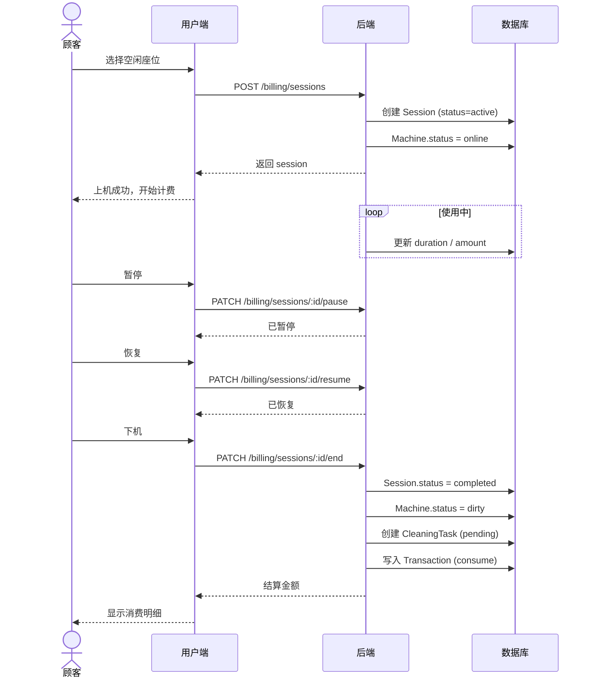
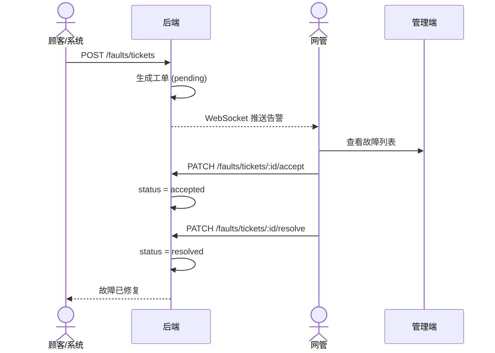
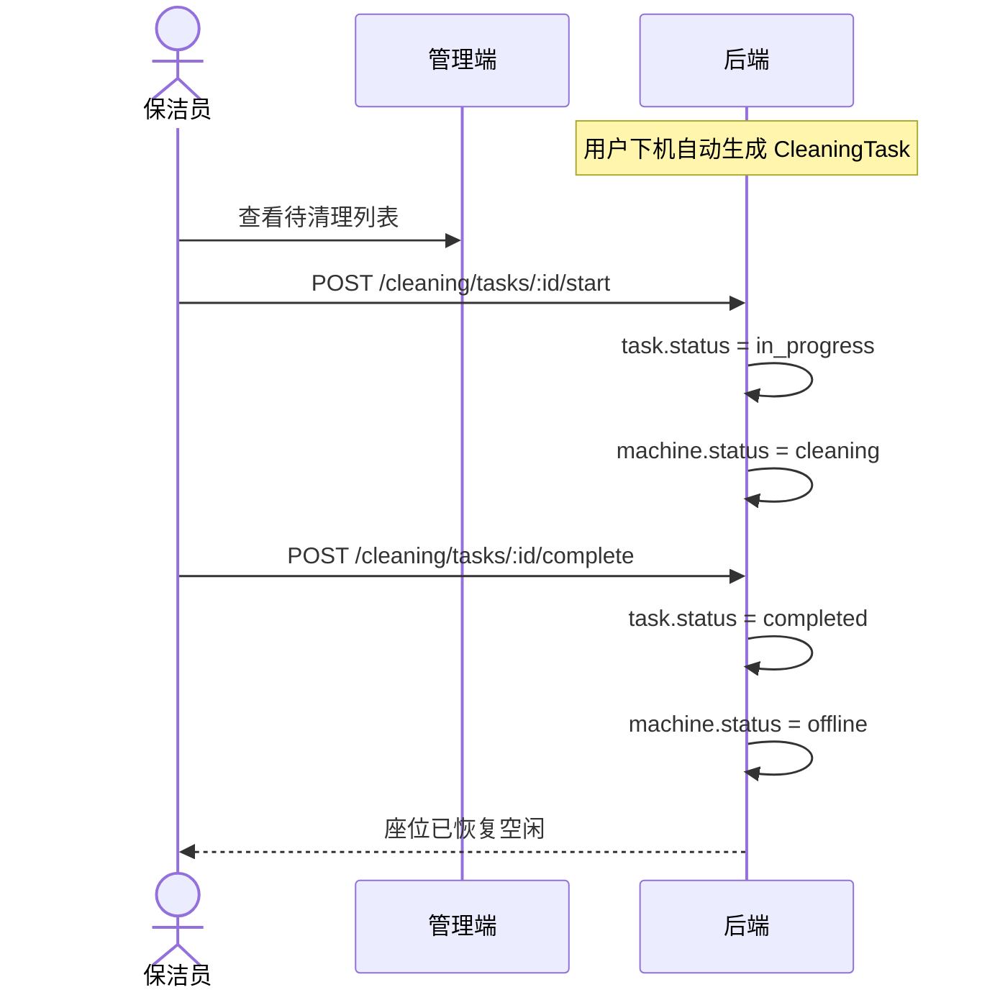
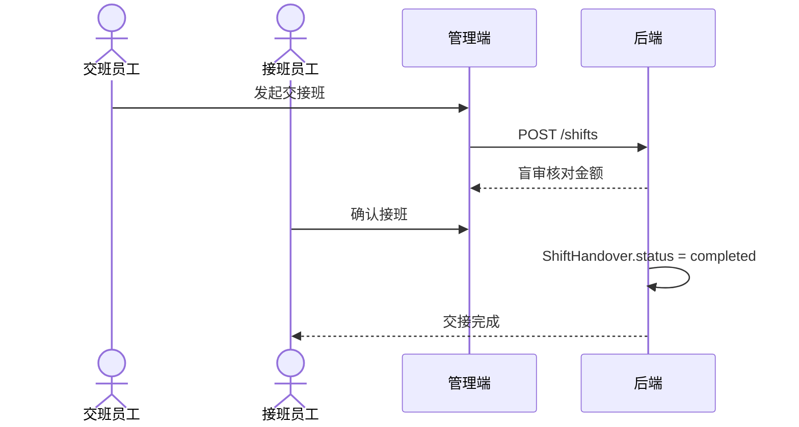
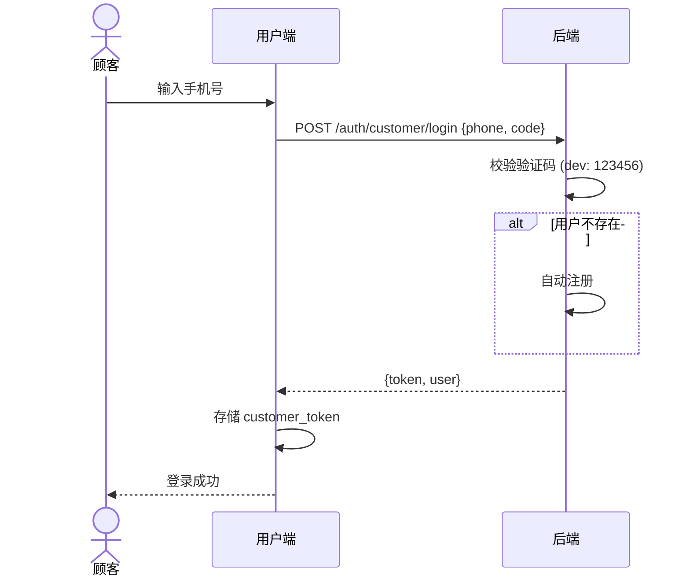

# 核心业务流程

> 文档状态（2026-10-21）：下文保留早期模型、流程或截图记录，测试数字与待办可能已变化。当前实现、验证与部署边界以[项目能力](project-showcase.md)、[架构](01-architecture.md)和[验证报告](validation-report.md)为准。

## 用户上机 → 下机结算

## 故障处理流程

## 保洁流程

## 交接班流程

## 顾客登录

