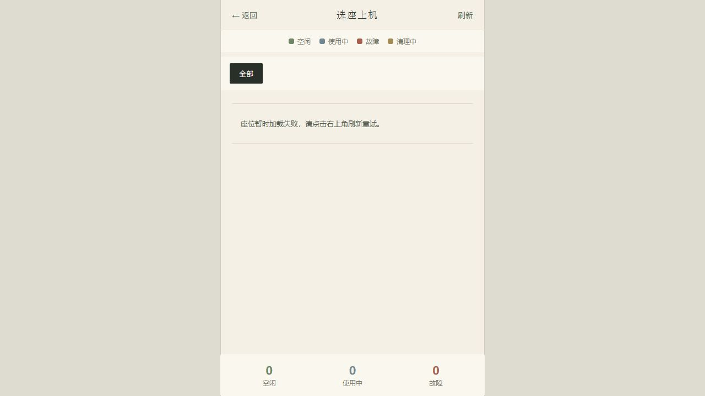
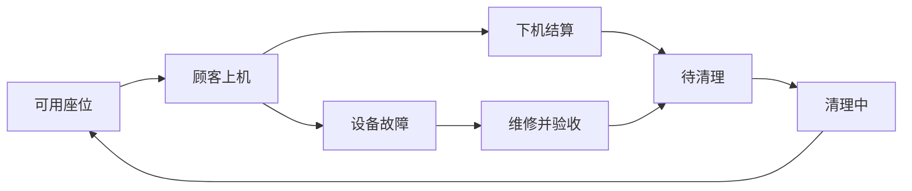
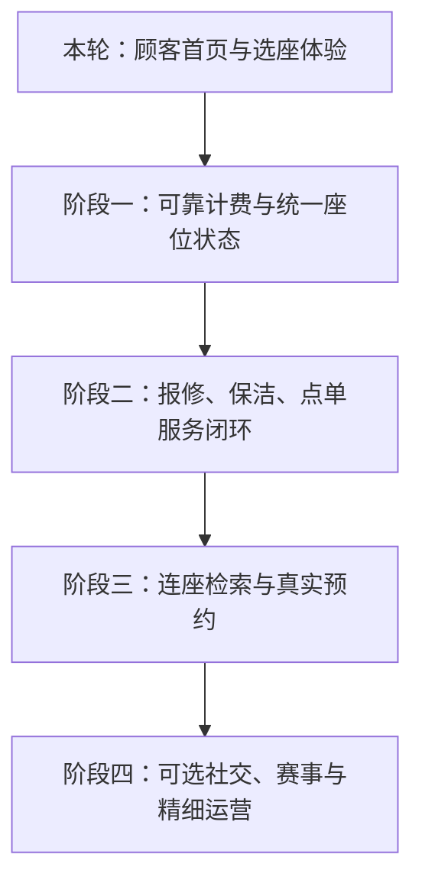

# WangBa-X 现代网吧系统 · 图文说明

> 面向年轻顾客的电竞空间服务系统，让顾客选得明白、消费放心，让店员处理问题更顺手。
>
> 编制日期：2026年10月17日。除下方水墨版实拍外，本文业务配图来自项目原有演示截图；其中价格、人数及营收不代表真实门店数据。

## 最新进展：本地业务已联通

后端、顾客端和管理端现已通过本地演示库联通，完整类型检查问题也已修复。以下早期水墨截图中的“后端未连接”状态为历史记录，最新操作截图、运行方式和验证结果见[本地仿真图文说明](06-local-simulation.md)。

## 水墨视觉更新 · 2026年10月17日

新版首页采用暖纸底色、墨色正文、朱砂印记与松绿状态，配合宋体标题、细线分隔和留白。山水为项目内原创SVG装饰，不包含外部品牌素材；选座、茶饮、报修和账户使用统一线条图标。移除了前版英文大标语、荧光绿、超大X装饰和emoji入口。

参考[网鱼官方网站](https://www.wywk.cn/wywk)对门店与体验的展示思路，保留直达服务的组织方式，不复制其标识、主题装潢和页面素材。当前“网吧 X”为项目名称，不代表新增真实门店品牌。

顾客端选座、点单、报修、账户与登录页同步了基础配色、字体和组件样式。本轮浏览器实查首页、选座页与跳转；其他页面尚未逐个完成视觉验收。管理后台未改为水墨主题。

截图为本地运行实拍。截图时后端未连接，故展示真实的加载失败提示；没有用演示空位冒充线上数据。新版首页区域与费用数据展示需后端可用后进一步联调。

验证：本轮Vite生产打包通过、原有7项顾客端测试通过；原有vue-tsc兼容问题仍待处理，尚未完成全量类型检查。

## 一、为什么要升级：从管理机器走向服务顾客

顾客走进网吧，通常不是为了操作一套管理软件。他可能只想在预算内找到合适座位，和朋友坐在一起，或者在设备出问题时尽快恢复游戏。

现代化系统应把这些具体任务放在最显眼的位置：先展示空位和价格，再进入选座；上机后集中提供点单、报修和账单入口；后台把每个服务请求交给明确的责任人。

| 典型场景 | 需要解决的问题 | 系统应提供的体验 |
|---|---|---|
| 下班后想玩两小时 | 不确定有没有位置、需要多少钱 | 提前看区域空位和基础估价 |
| 三个朋友一起到店 | 分散空位不能满足同行需要 | 根据真实布局找连座，统一锁定（规划） |
| 游戏途中鼠标失灵 | 反复找网管，等待没有进度 | 报修后可查看处理状态，必要时换机（闭环待完善） |
| 想点一杯饮料 | 离开座位打断游戏 | 在顾客端点单，送到当前座位 |
| 准备离店 | 不理解最终扣费 | 展示适用规则及费用明细（待深化） |

以上是待门店访谈验证的场景假设，尚不能视为已完成用户调研。

## 二、顾客端：服务入口围绕一次上机展开

**图1说明：** 原有界面已经集中提供选座、水吧、报修和账户入口，并用颜色区分座位状态。这些入口构成了顾客服务的基础。但原首页把区域、包间和价格写在页面中，难以适配不同门店，也容易让顾客误以为展示价格就是实际配置。

### 本轮首页已经做了哪些改善

| 位置 | 改善内容 | 顾客获得的帮助 |
|---|---|---|
| 首屏 | 电竞风格、突出查看座位入口 | 更快找到首要操作 |
| 门店状态 | 从接口读取空位和上机人数 | 减少依赖静态展示 |
| 区域卡片 | 从接口读取区域名称、单价与空位 | 门店调整区域后，首页随数据变化 |
| 时长选择 | 提供1、2、3、5小时基础网费试算 | 消费前有预算参照 |
| 空位筛选 | 只看有空位的区域 | 减少无效浏览 |
| 区域跳转 | 点击后进入该区域座位列表 | 无需再次手动筛选 |
| 异常提示 | 区分加载中、失败、无区域及无空位 | 避免把接口失败误认为门店没有座位 |

**预算示例：** 如果门店接口返回某区域为10元/小时，选择3小时后，首页展示基础网费约30元。这只是计算示例，不是当前门店报价。会员折扣、包时和餐饮需按实际规则结算。

*图2：当前顾客体验的主要路径。查看空位不代表预约成功，也不会锁定座位。*

## 三、座位管理：有空位，还要确保能正常使用

**图3说明：** 后台通过区域与状态区分座位，帮助店员发现占用、故障、待清理和清理中的机器。真正影响体验的是状态是否准确：机器没人使用，但尚未清理或正在维修时，不应该继续出售。

建议后续把设备在线状态与座位可售状态分开。设备断线不一定代表有空位；设备在线也不一定代表正在计费。

*图4：建议完善的座位业务状态流转，属于目标流程，并非本轮已完成的完整状态机。*

多人同行则需要进一步加入真实布局、整组锁座和预约过期释放。不能只按座位编号相邻，就认为实际座位在一起。

## 四、报修与保洁：把“有人反映”变成“有人处理到结束”

**图5说明：** 故障管理承担问题记录与处理。下一步应将顾客报修与后台任务连接起来，让顾客看到“已受理、处理中、已恢复”，让店员看到责任人和等待时长。

例如，顾客反馈耳机无声音后，系统应绑定当前座位和会话，店员受理后更新进度。若需要换机，应保留正确的计费关系；是否补偿、补偿多少应由门店规则决定并留下记录。

**图6说明：** 保洁决定了空位能否真正交给下一位顾客。目标是下机触发任务、员工领取任务、完成确认后恢复可售；任务超时则提醒当班负责人。这一完整闭环需要后续联调验证。

## 五、计费与交班：每一笔消费都有依据

**图7说明：** 计费页面是经营基础。首页试算解决“预计多少钱”，正式账单则要回答“为什么收这些钱”。后续需完善计费规则快照、换机和暂停处理、重复请求保护，以及退款独立流水。

**图8说明：** 交班不应只交一个营业额数字，还要交清未完成订单、未处理故障和资金差异。这样下一班才能接着处理，不必重新向顾客询问。

| 交班内容 | 应能追溯到什么 |
|---|---|
| 上机收入 | 对应会话、计费规则与结算记录 |
| 水吧收入 | 对应商品订单与履约状态 |
| 退款或赠送 | 原交易、操作人及原因 |
| 未处理事项 | 工单、责任人及最后更新时间 |

表格为目标验收标准，不能仅凭现有截图判断全部已实现。

## 六、年轻化设计：清楚、自由、少打扰

年轻顾客之间也有差异：有人想组队，有人只想安静玩游戏。系统应提供选择，而不是要求每个人参与社交。

- **清楚：** 价格、空位、服务状态容易理解，状态不能只依靠颜色表达。
- **自由：** 开黑房间、活动和偏好由顾客主动选择，可以退出。
- **少打扰：** 重要余额或服务提醒及时出现，营销信息不过度打断游戏。
- **有边界：** 不公开其他顾客的真实身份，不收集游戏密码，个人配置同步需要明确授权。

本轮已将前版暗色电竞主题更新为暖纸水墨主题。字体、对比度、键盘操作和小屏可用性仍应在真实浏览器与门店设备中继续验收。

## 七、完整建设顺序：先可靠，再扩展

*图9：实施路线。除本轮列明的首页改进外，其余属于后续建设范围。*

| 优先级 | 主要工作 | 完成的判断依据 |
|---|---|---|
| 第一阶段 | 鉴权、原子上机、幂等结算、统一可售状态 | 抢座不冲突、重复结算不多扣钱、用户不能操作他人会话 |
| 第二阶段 | 工单分派、服务进度、库存与退款、保洁联动 | 每个请求可追溯，异常有负责人 |
| 第三阶段 | 真实布局连座、预约锁定、超时释放 | 整组预约一致成功或失败，过期自动释放 |
| 第四阶段 | 开黑房间、活动与会员体验 | 自愿参与、可退出，并有试点数据支持 |

## 八、市场依据与交付边界

[顺网官方产品目录](https://www.shunwang.com/product.html)显示，成熟厂商已提供计费、会员营销、财务及移动管理能力。因此本项目的竞争方向应通过实际选座效率、服务响应和消费透明度验证。

[顺网2025—2026电竞实体消费场景报告发布页](https://www.shunwang.com/news/494.html)提供了复合消费和电竞空间发展的行业观察。厂商研究有其商业立场，不能直接证明本项目能够提升营收，也不能替代本地门店访谈。

完整证据说明、痛点假设和试点方法见[市场调研与产品方案](04-market-product-plan.md)。建议先采集一周基线，再开展两周单店试点，观察选座耗时、报修响应、账单争议及员工重复沟通次数，再调整优先级。

**当前交付：** 市场案头调研、完整产品路线图、顾客首页首轮改造及区域筛选联动。现有7项顾客端测试通过，Vite生产打包通过；完整类型检查被原有工具兼容问题阻断。尚未完成新版浏览器视觉验收、真实门店试点、支付接入、实名对接及硬件遥测，不能宣称生产系统已经全部建成。

## 后续界面更新

最新大厅选座与管理端水墨界面见[新版界面图文说明](07-hall-ink-admin.md)。
