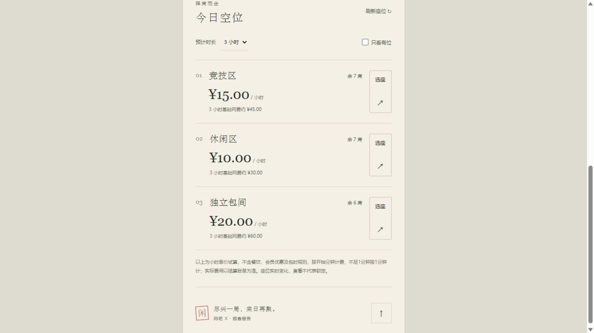
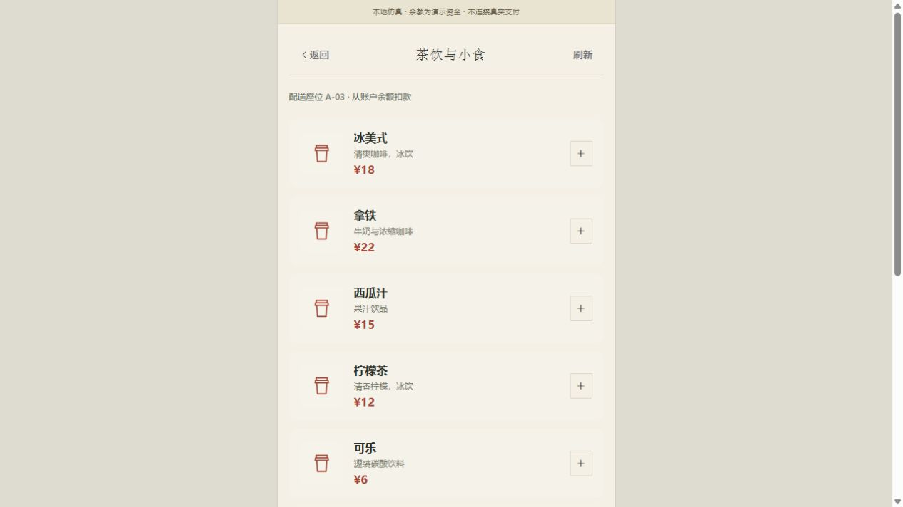
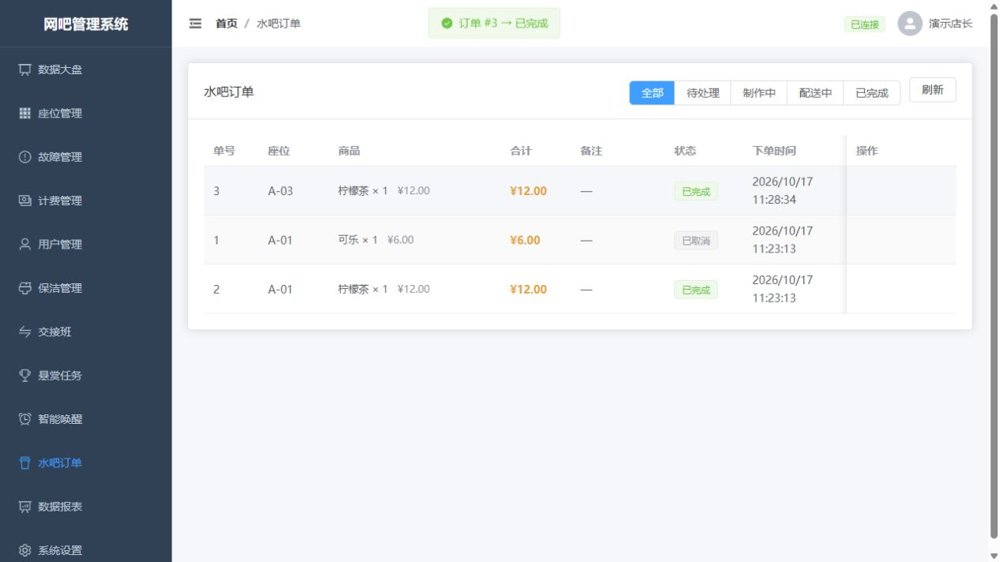
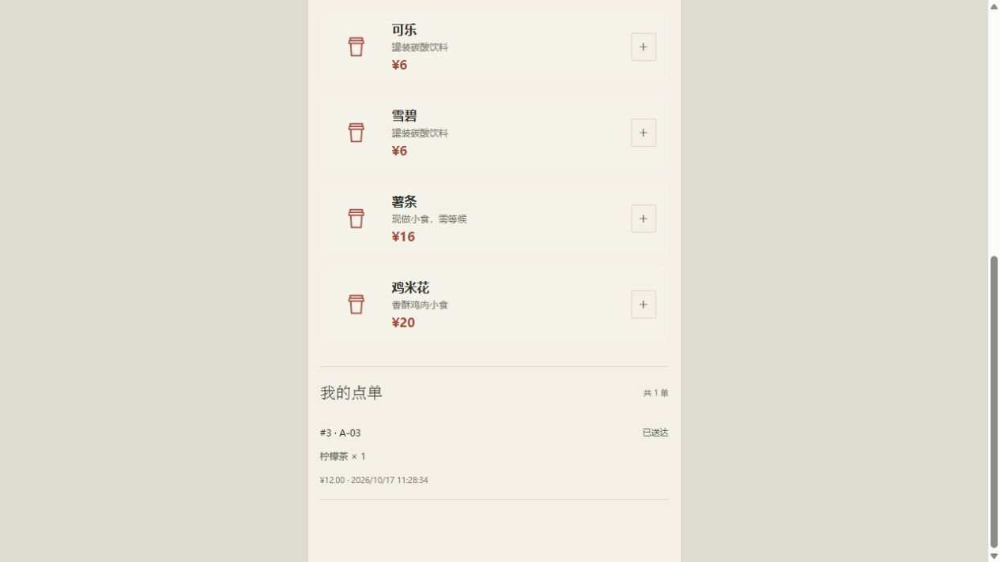
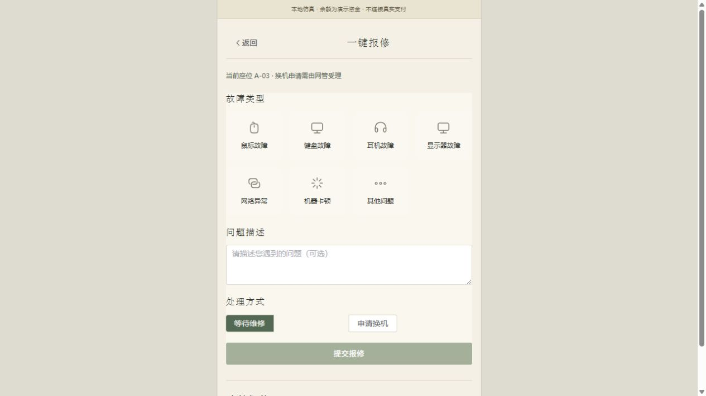
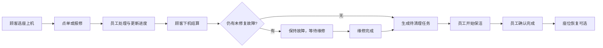
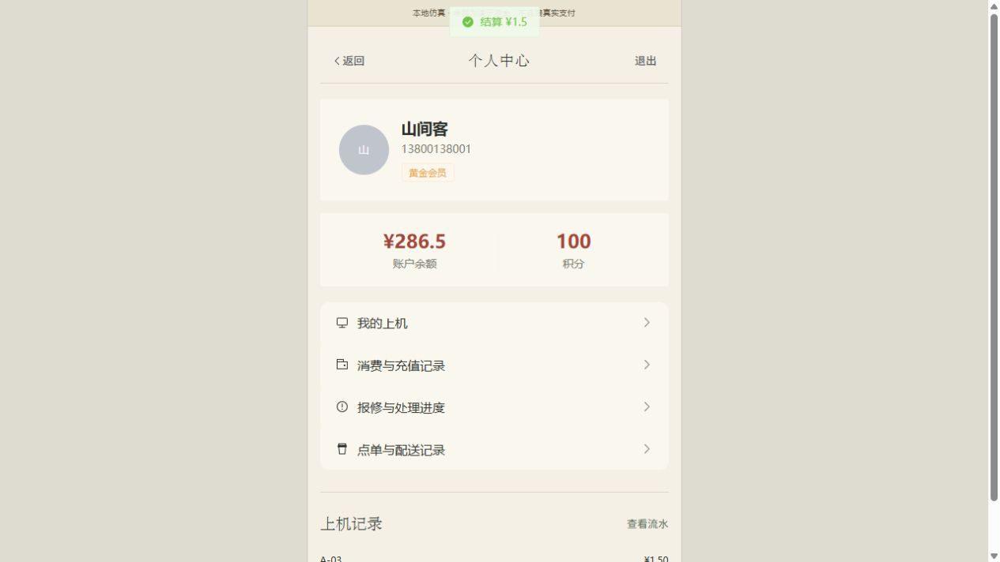

# WangBa-X 本地仿真 · 运行与验收说明

> 文档状态（2026-10-21）：下文保留早期模型、流程或截图记录，测试数字与待办可能已变化。当前实现、验证与部署边界以[项目能力](project-showcase.md)、[架构](01-architecture.md)和[验证报告](validation-report.md)为准。


本轮交付日期：2026年10月17日。顾客端、管理端与NestJS后端已经在本机联通，数据保存在独立SQLite演示库中。这里的余额、餐饮扣款和充值均为演示记账，不连接真实支付、短信、实名系统或电脑硬件。

## 1. 直接打开

| 入口 | 地址 | 演示登录 |
|---|---|---|
| 顾客端 | http://127.0.0.1:5180 | 手机号13800138001，验证码123456 |
| 管理端 | http://127.0.0.1:5173 | admin / admin123 |
| API文档 | http://127.0.0.1:3000/api | 需要权限的接口使用对应登录令牌 |
| 服务状态 | http://127.0.0.1:3000/health | 返回mode=demo表示本地仿真 |

顾客演示账号13800138001—13800138005首次初始化各有300元演示余额。浏览器验收已在第一个账号中留下点单及上机消费，当前余额不一定仍为300元。重复启动保留操作记录，不会自动补钱或清空数据；需要增加余额可由演示店长在计费管理中充值记账。

## 2. 重启方法

要求Node.js 22或更新版本。当前电脑依赖已经准备好，可以双击项目根目录的`start-local.bat`，或在根目录执行：

```powershell
npm run dev:local
```

首次复制到其他电脑时，先安装依赖：

```powershell
npm run setup:local
npm run dev:local
```

脚本会编译后端、幂等初始化演示库，然后启动后端、顾客端与管理端。服务绑定127.0.0.1；端口被其他应用占用时会报错，不会强制结束其他进程。能识别的既有前端服务会复用。

在启动终端按Ctrl+C可停止本次启动的服务；复用的前端服务需到它原来的终端停止。后端源码修改后需重启此命令，前端页面修改会热更新。

| 本地文件 | 用途 |
|---|---|
| `.local/demo.sqlite` | 独立演示数据库，与原有netcafe.db分开 |
| `.local/jwt-secret` | 本机生成的演示令牌签名密钥，重启保持不变 |
| `.local/smoke-results.json` | 最近一次业务检查结果 |

`.local`已加入忽略规则。原有`backend/node_modules.incomplete`是修复安装时保留的旧依赖备份，当前服务使用新安装的`backend/node_modules`。

## 3. 顾客首页：真实数据进入水墨界面


首页不再展示“后端未连接”，可读取门店区域、单价和空位；页面顶部明确标注本地仿真。背景山水只负责视觉表达，座位与价格仍由业务接口提供。



初始演示配置为3个区域、22个座位，包含1个待清理座位和1个故障座位，可用于测试非可售状态。截图中的空位数量会随操作变化，不应作为固定宣传数字。

本地演示计费规则：按开始分钟计费，不足1分钟按1分钟计；按上机时的区域单价保存费率快照，结算金额四舍五入至分。换机保留原会话费率，不另外产生第二笔上机会话。该规则是本轮可运行的基础计费规则，不包含完整会员折扣或包夜引擎。

## 4. 点单：前台和后台能操作同一笔订单



菜单由后端提供，顾客可以增减商品数量。需要先上机才能下单；服务端绑定本人当前座位、重新核算单价与总额，余额不足时拒绝提交。



浏览器验收中，顾客提交一杯柠檬茶，后台找到同一单号，依次接单、送出、完成。取消只允许在待接单或制作中执行，并退回顾客账户余额；重复取消不会重复退款。



顾客端显示同一订单已送达。订单与报修记录每15秒刷新，也可以手动刷新。当前菜单为服务器内的演示商品目录，尚未实现库存、商品编辑或真实配送服务。

## 5. 报修、换机与保洁



故障类型从后端加载，顾客只能为自己当前上机座位报修；重复报同类未关闭问题会得到明确提示。记录显示待受理、已受理或已修复等实际状态。

申请换机由员工在后台受理并选择空闲座位。服务端迁移原会话，原机器保持故障并继续维修，不会因为顾客换走就自动变成可售。



浏览器验收已经实际完成A-03的下机、生成保洁任务、员工开始保洁及确认完成。后台不再用定时动画冒充清理完成度；清理中任务来自数据库，刷新后仍能看到。

## 6. 账户与消费记录



顾客端增加上机记录、消费和充值流水、点单及报修记录入口。下机与点单后刷新余额；临时网络失败不会直接抹掉已知上机会话或强制退出，令牌确实过期时才清除登录状态。

## 7. 本轮修复清单

| 发现的问题 | 本轮处理 |
|---|---|
| 后端依赖残缺，无法编译和启动 | 重新安装完整依赖，修正后端编译范围及增量输出问题 |
| 前端vue-tsc与TypeScript不兼容 | 更新检查工具，修正解包后的API返回类型及组件类型 |
| 登录假装发送短信 | 明确演示模式，手动填入演示码；非演示或生产环境禁用固定码登录 |
| 用户可尝试修改他人会话和记录 | 会话、订单、报修按顾客身份隔离，关键员工接口拒绝顾客令牌 |
| 上机与机器状态分步修改 | 单进程事务队列，统一保存会话、占用及费率快照 |
| 暂停时仍累计费用 | 按暂停时间冻结计费，恢复时扣除真实暂停时长 |
| 重复结算重复扣款 | 已完成会话返回原结算结果，扣款、流水、座位状态与保洁任务同事务提交 |
| 点单完全相信前端价格 | 后端目录重新定价，事务扣款；订单取消事务退款 |
| 报修/换机导致座位状态与会话脱节 | 绑定当前会话，换机迁移会话，原机器继续维修 |
| 已经开始的保洁任务刷新后丢失 | 接口返回待处理和清理中任务，前端按实际状态分组 |
| 后台直接切状态绕过结算或保洁 | 座位页引导进入计费、工单和保洁流程，服务端增加状态检查 |
| 报表日期下界被覆盖，退款计入收入 | 改为完整日期范围过滤，营收按消费减退款计算 |
| 管理端首次导航反复刷新 | 去除重复组件自动导入，保留统一的Element Plus注册 |
| 顾客页面残留深色主题白字 | 修正标题、报修选项等文字对比度，保留水墨风格 |

## 8. 如何复验

保持本地仿真运行，在根目录执行：

```powershell
npm run test:local
```

此命令会向演示库新增测试用户、订单和流水，完成后把占用的测试座位恢复可用；运行前会检查服务为demo模式。至少需要2个空闲座位。测试不是对生产服务执行的只读检查，也不应把LOCAL_API指向其他环境。

本轮结果：13组HTTP业务检查通过，覆盖错误验证码、余额不足、越权、并发抢座、暂停、后端定价、订单退款及履约、报修换机、并发结算、保洁、员工资料和报表。顾客端10项Vitest测试通过，管理端35项Vitest测试通过。后端编译、顾客端完整类型检查及构建、管理端完整类型检查及构建均通过。

另已在浏览器实测：顾客登录→A-03上机→柠檬茶下单→后台接单/配送/完成→顾客显示已送达→下机结算→后台保洁→恢复空闲。以上截图来自这次实际操作。

## 9. 继续优化的边界

当前是本机单进程演示环境，事务队列用于解决SQLite连接内的并发；它不是多进程部署或生产支付的完整一致性方案。尚未覆盖完整生产权限审计、严格的所有请求DTO、分布式并发锁及数据库迁移。

下一批优先项是：订单请求幂等键与网络超时后的订单确认、商品库存与售罄、计费规则与会员优惠、报修换机后的通知、店员职责权限细分，以及真实设备代理。连座预约、包夜计费、真实支付/退款、短信和实名核验尚未完成。本地演示不应被当作这些服务已经接入。

构建仍有Sass旧API和大体积包提示；管理端测试还有测试环境图标注册提示。本轮通过检查不等于生产上线验收。
