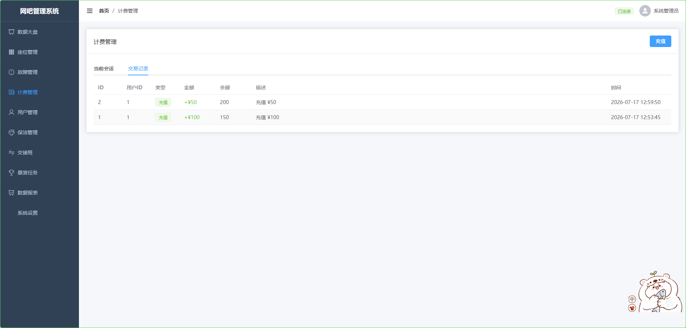

# 计费管理

## 能力说明

查看当前上机会话、历史交易记录，支持手动充值。多种计费策略：按时计费、包夜、阶梯计费，支持会员折扣。

## 界面标注

① **活跃会话** — 当前上机中的用户/机器/时长/金额 
② **交易记录** — 充值/消费/赠送/退款流水 
③ **充值弹窗** — 选择用户、金额、支付方式 
④ **计费策略** — 区域单价、包夜时段配置入口

## 接口

| 方法 | 路径 | 说明 |
|------|------|------|
| GET | `/billing/sessions?status=active` | 活跃会话 |
| POST | `/billing/sessions` | 开始上机 |
| PATCH | `/billing/sessions/:id/end` | 结束上机 |
| PATCH | `/billing/sessions/:id/pause` | 暂停 |
| PATCH | `/billing/sessions/:id/resume` | 恢复 |
| GET | `/billing/transactions` | 交易记录 |
| POST | `/billing/recharge` | 充值 |
