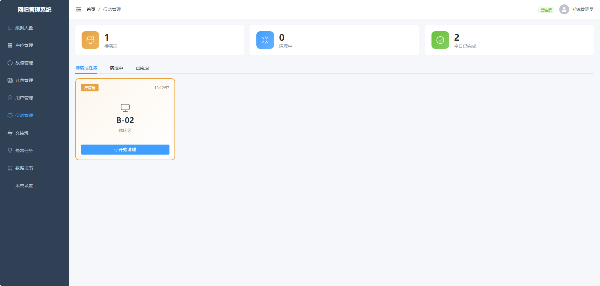

# 保洁管理

## 能力说明

用户下机自动生成保洁任务，保洁状态机闭环：待清理 → 清理中 → 已完成。支持扫码确认完成。

## 界面标注

① **待清理列表** — 机器编号、区域、下机时间、等待时长 
② **清理中列表** — 处理人、开始时间、已耗时 
③ **已完成列表** — 完成时间、耗时、保洁员 
④ **操作** — 开始清理 / 完成清理

## 接口

| 方法 | 路径 | 说明 |
|------|------|------|
| GET | `/cleaning/tasks/pending` | 待处理任务 |
| GET | `/cleaning/tasks/completed` | 已完成任务 |
| POST | `/cleaning/tasks/:id/start` | 开始清理 |
| POST | `/cleaning/tasks/:id/complete` | 完成清理 |
