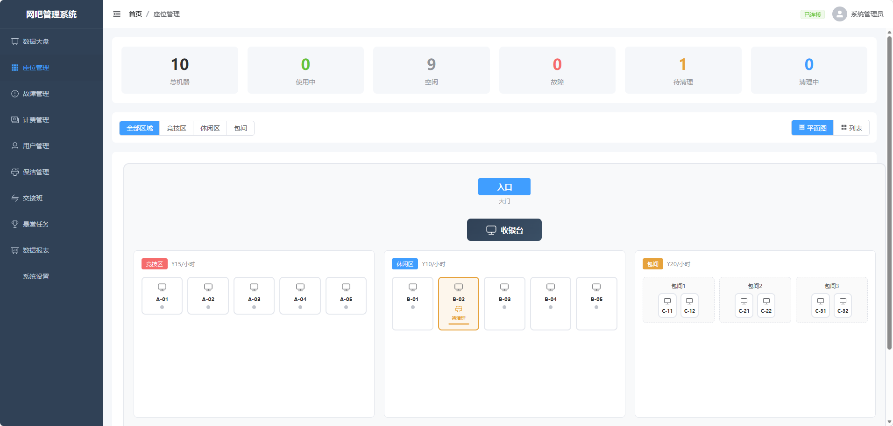

# 座位管理

## 能力说明

可视化座位图，支持平面图/列表双视图切换。实时显示座位状态（空闲/使用中/故障/保洁中），支持下机、报修、换机等操作。

## 界面标注

① **区域筛选** — 按竞技区/休闲区/包间筛选 
② **视图切换** — 平面图 / 列表两种展示模式 
③ **座位卡片** — 显示机器编号、状态、当前用户、上机时长 
④ **操作按钮** — 下机、报修、换机、查看详情

## 接口

| 方法 | 路径 | 说明 |
|------|------|------|
| GET | `/machines?areaId=&status=` | 获取机器列表 |
| GET | `/areas` | 获取区域列表 |
| PATCH | `/machines/:id/status` | 更新机器状态 |
| POST | `/billing/sessions` | 开始上机 |
| PATCH | `/billing/sessions/:id/end` | 结束上机 |
| POST | `/faults/tickets` | 报修 |
