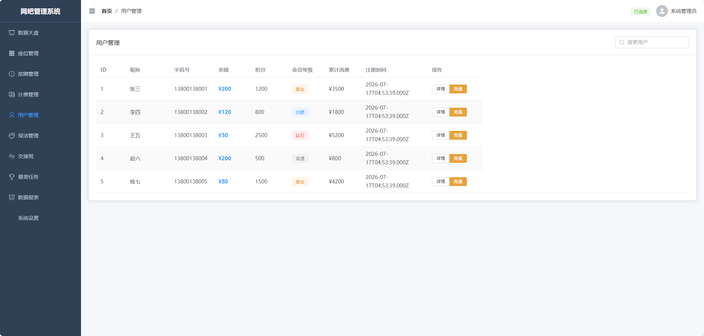

# 用户管理

## 能力说明

管理网吧会员/顾客信息：余额、积分、会员等级、上机记录。支持创建、编辑、删除用户，以及余额充值。

## 界面标注

① **搜索栏** — 按昵称/手机号搜索 
② **用户列表** — 昵称、手机号、余额、积分、会员等级、注册时间 
③ **操作** — 查看详情、充值、编辑、删除 
④ **新建用户** — 手动录入顾客

## 接口

| 方法 | 路径 | 说明 |
|------|------|------|
| GET | `/users` | 用户列表 |
| GET | `/users/:id` | 用户详情 |
| POST | `/users` | 创建用户 |
| PATCH | `/users/:id` | 更新用户 |
| DELETE | `/users/:id` | 删除用户 |
| POST | `/billing/recharge` | 余额充值 |
